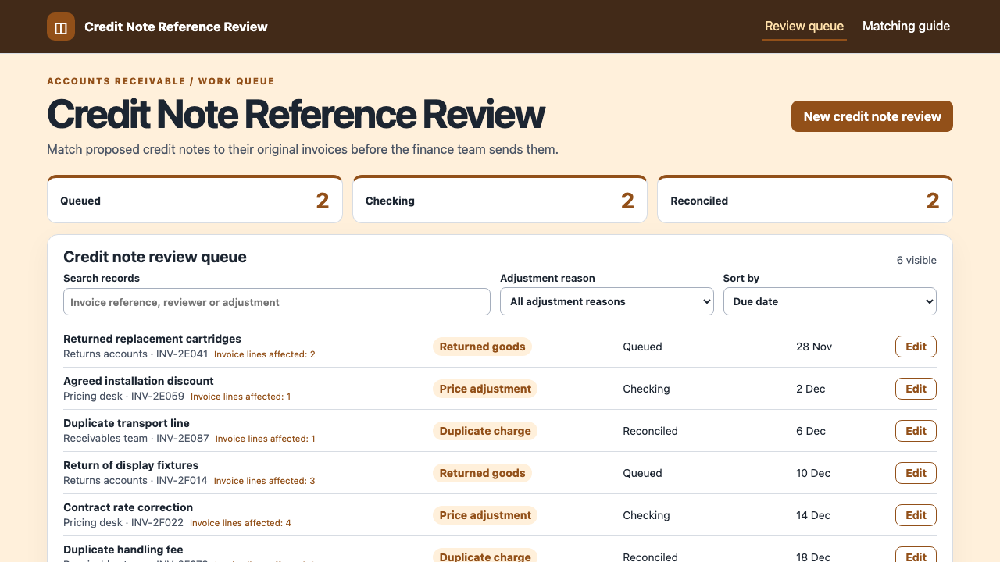
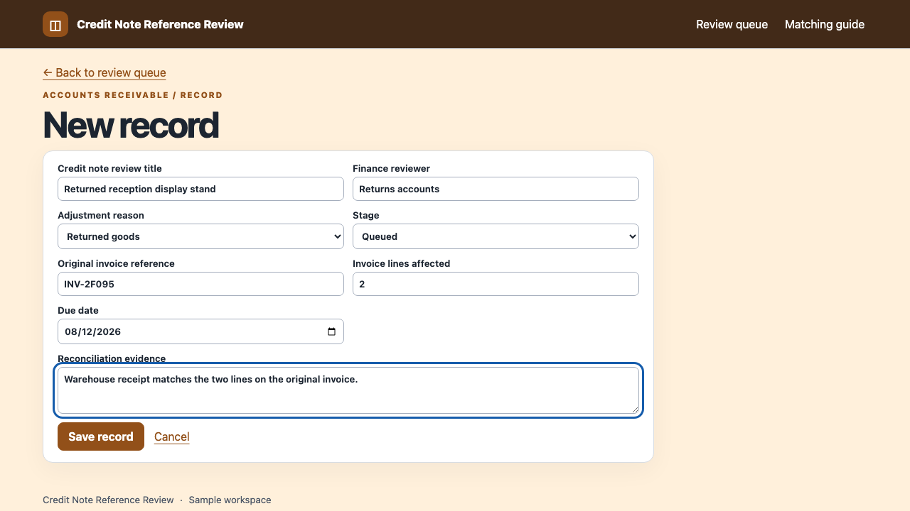

# Credit Note Reference Review

Match proposed credit notes to their original invoices before the finance team sends them.

## Live demo

[Watch the recorded walkthrough](docs/demo.webm). Follow the installation steps to try it locally.

## Screenshots

## Main features

- Find records by title, owner, reference, stage or notes. Filter by adjustment reason and sort by title or due date.
- Create and edit records with a checked invoice lines affected value and a due date.
- See counts by stage, follow the matching guide, and record evidence before closing a review.

## Technology used

Vue, TypeScript, Java 21, Spring Boot, JDBC and H2.

## Installation instructions

Use Node.js 24, Java 21 and Maven. From `backend/` run `mvn spring-boot:run`. From the project root run `npm ci` and `npm run dev`. Open the address printed by the frontend.

## Commercial licensing/contact

Contact [Amitesh2022](https://github.com/Amitesh2022) for commercial licensing.

## Business problem and users

Finance reviewers need to link adjustments to the original structured invoice and check what changed before the document leaves their team. [Official background](https://einvoice.belgium.be/en/FAQ/specific-questions-about-e-invoicing).

## Key workflows

Open the queue, filter for a relevant record, create or revise it, then move it to the next stage. Close the review only after both the invoice reference and the affected lines have been checked. This desk does not issue or transmit documents.

## Framework highlights

Vue uses a single-file component, Composition API, reactive state and computed filters.

## Java backend highlights

Spring Boot separates the HTTP API, validation and JDBC repository. It provides list and search, create and update, structured validation errors and a health endpoint. Records are stored in a local H2 database.

## Architecture and state flow

The frontend reads `/api/records` through its development proxy. The API validates each change and returns the stored record, which updates the queue. The queue, record editor and guide have separate hash routes.

## Accessibility and responsive behaviour

The app has labelled fields, visible focus, status announcements and text stage labels. Filters and records stack on narrow screens.

## Verification commands

- `npm test` and `npm run build`.
- `cd backend && mvn verify`.

## Structure

- `src/`: frontend, view state and tests.
- `backend/`: service, repository, database schema and Java integration tests.
- `docs/`: screenshots and walkthrough.

## Tradeoffs

This is a sample workspace, not an official or hosted service. Seed records are fictional. H2 simplifies local setup; sign-in and audit history are not included. Close the review only after both the invoice reference and the affected lines have been checked. This desk does not issue or transmit documents.

## Roadmap

Add an accounting import, reviewer sign-off and reconciliation export.
